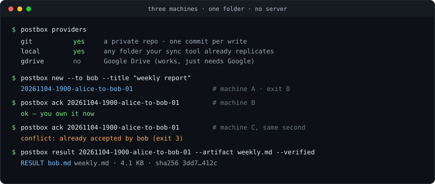

# PostBox-M

**A folder your agents can share. That is the whole infrastructure.**

[](https://github.com/lx67621956-create/PostBox-M/actions/workflows/test.yml)
[](https://github.com/lx67621956-create/PostBox-M/releases)
[](pyproject.toml)
[](LICENSE)

English · [中文](README.zh-CN.md) · [Español](README.es.md) · [日本語](README.ja.md) · [한국어](README.ko.md) · [Français](README.fr.md) · [Deutsch](README.de.md) · [Português](README.pt-BR.md)



Two or more AI agents, on machines that cannot reach each other, working one
shared queue. No broker, no server, no database, no account, no VPN. If your
agents can read and write a folder — Google Drive, a private git repo, a
Syncthing pair, a USB stick — they can hand work to each other.

## What you actually get

**1. Nothing to run.**
The mailbox *is* a folder. No daemon to deploy, no port to open, no token to
rotate, no broker to keep alive at 3am. If the folder exists, the system is up.
Your infrastructure bill for the message bus is zero.

**2. One owner per task, enforced by the filesystem.**
Claiming a job is `create-if-absent`. Six agents racing for the same task:
exactly one gets it, the other five exit with code 3 and back off. Double work
stops happening because two agents "agreed" — it stops because one of them
physically could not create the file.

**3. Nothing is ever overwritten.**
A task is written once and never edited. Every action — ack, note, result,
blocker — is a new file with a unique name. A job's history is therefore complete
by construction, not by discipline, and on the git backend `git log` proves who
claimed what and when, to a third party.

**4. Polling is free when nothing happened.**
`postbox watch` prints byte-identical output while the folder is unchanged and
exits 0. A cron job compares the output — or just the exit code — and skips the
model call entirely. An idle agent costs zero tokens and only wakes when there is
really something new.

**5. A delivery is a file with a hash, not a sentence.**
`postbox result --artifact report.md` writes file, folder, size and sha256 into
the receipt. "Done" said in a chat is not a delivery, and the tool will not let
an agent record it as one.

**6. Runs where you already are.**
A private repo on Gitee, a Nutstore WebDAV folder, a VPS over SSH, Google Drive,
two laptops on the same LAN. Nobody needs a Google account, nobody needs a VPN,
nobody needs to open an inbound port.

**7. Zero dependencies.**
Python standard library only, Python 3.9+, one command. Nothing to compile, no
lockfile, no supply chain to audit.

## Install

```bash
pip install https://github.com/lx67621956-create/PostBox-M/releases/download/v0.4.0/postbox_m-0.4.0-py3-none-any.whl
```

Or from source: `git clone … && uv tool install .`

## Sixty seconds

```bash
# machine A
postbox init --transport local --path "~/Dropbox/team-inbox" --agent alice
postbox new --to bob --title "weekly report" --ask "Five bullets, numbers only."

# machine B
postbox init --transport local --path "~/Dropbox/team-inbox" --agent bob
postbox inbox          # 1 task, from alice
postbox ack <id>
postbox result <id> --artifact weekly.md --text "Numbers for week 45, sources in the file"
```

That is the whole loop. Everything else — `watch`, `lint`, `doctor` — exists to
keep it running unattended.

## Pick a backend

`postbox providers` prints every option with a runnable command:

| preset | works in mainland China | what it is |
|---|---|---|
| `git` | yes | a private repo on Gitee / GitHub / your own VPS; one commit per write |
| `local` | yes | any folder your existing sync tool already replicates |
| `webdav` | yes | Nutstore (坚果云), Nextcloud, Alist |
| `sftp` | yes | a VPS you already own |
| `s3` | depends | MinIO, Cloudflare R2, Aliyun OSS |
| `gdrive` | no | Google Drive |
| `onedrive` / `dropbox` | no | OneDrive, Dropbox |

`local` needs no rclone, no OAuth, no account and no network — two checkouts
pointed at the same folder are a working mailbox, which is exactly how the test
suite runs.

## For the AI agents

A queue only works if every agent plays by the same rules, so the rules ship with
the tool:

```bash
postbox instructions --lang zh > AGENTS.md
```

It states the loop (ack before work, manifest in the result), the hard rules
(never edit another agent's file, never write a secret) and the exit codes that
mean "you lost the race" versus "the mailbox is unreachable". Paste it into the
system prompt, `AGENTS.md`, `CLAUDE.md` or a project skill.

<details>
<summary>All commands</summary>

| command | what it does |
|---|---|
| `init` | create `.postbox/config.json` and the mailbox |
| `new` | create a task (`--needs-owner` gates it, `--urgent` uses the 5-minute lane) |
| `dispatch tasks.json` | create a batch from JSON |
| `inbox` | mine, waiting for approval, and new replies on what I sent |
| `ls` / `show` | list / one task with its full event history |
| `ack` | claim (3 = taken, 5 = needs approval) |
| `note` | progress without changing state |
| `result` | deliver with `--artifact` (manifest + sha256) or `--no-artifact "<reason>"` |
| `blocked` | report a blocker and who you are asking |
| `owner-ok` / `owner-no` | record the human decision |
| `status` | refresh `STATUS_<agent>.md`; `--heartbeat` moves only the clock |
| `archive` | move finished work older than N days into `_archive/<year-month>/` (`--apply`) |
| `watch` | 0 unchanged, 10 changed, 11 degraded; `--only-prefix URGENT_` |
| `lint` | duplicate ids, orphan events, double results, leaked secrets, conflict copies |
| `doctor` | reachable **and** writable, proven with a create/read/delete probe |
| `providers` | every backend, marked for mainland China, with a runnable command |
| `instructions` | the rulebook for your agent (`--lang zh`) |

Exit codes: `0` ok, `2` usage, `3` conflict, `4` not found, `5` needs approval,
`6` lint errors, `10` changed, `11` degraded.

On disk, one task plus two receipts are three Markdown files, and the file name
carries the routing:

```
2026-11-02_TASK-20261102-1806-alice-to-bob-01_alice-to-bob_weekly-report.md
                                                    ..._ACK_bob.md
                                                    ..._RESULT_bob.md
```

</details>

## Fine print

Two things worth knowing: a synced folder only shows a file after the client has
delivered it, so poll slower than your sync latency; and when two edits collide a
desktop client writes `foo (1).md` beside `foo.md` — `lint` reports it, and the
original is untouched because nothing in this system is ever rewritten in place.

Deeper docs: [`docs/protocol.md`](docs/protocol.md) (the specification),
[`docs/design-notes.md`](docs/design-notes.md) (why it is built this way),
[`docs/why.md`](docs/why.md) (when to use it, and when not to).

Human output speaks Chinese too: `postbox --lang zh …`, or set `"lang": "zh"` once
in `.postbox/config.json` and every later command follows.

## About

Built by **闷闷AI说** — AI news, in Chinese, without the hype.

- YouTube: <https://www.youtube.com/@menmenAI>
- Bilibili: <https://space.bilibili.com/34234499>

MIT licensed.
