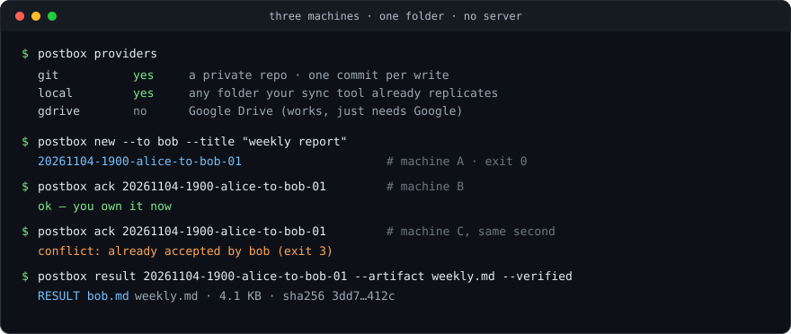
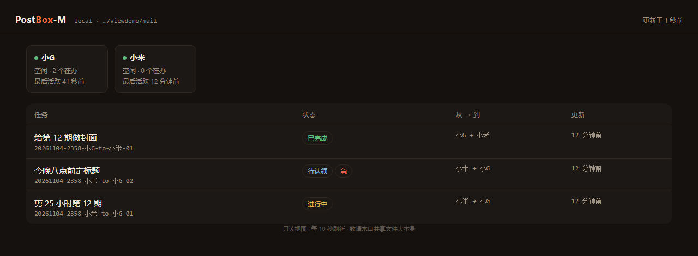

# PostBox-M

**人在外面，也能给另一台电脑派活。**

[](https://github.com/lx67621956-create/PostBox-M/actions/workflows/test.yml)
[](https://github.com/lx67621956-create/PostBox-M/releases)
[](pyproject.toml)
[](LICENSE)

[English](README.md) · 中文 · [Español](README.es.md) · [日本語](README.ja.md) · [한국어](README.ko.md) · [Français](README.fr.md) · [Deutsch](README.de.md) · [Português](README.pt-BR.md)





<sub>`postbox serve` —— 只读，跑在你自己机器上，读的就是那个你已经在共享的文件夹。不要账号、不要数据库、不用部署。</sub>


你在外面，只带着手机。跟手机上的 AI 说一句：这事交给家里那台电脑办。它就派过去了——派给另一座城市的公司电脑，派给常年开着的云服务器，派给家里那台。那台机器上的 AI 接过活，自己干，干完把文件留在本地，再交一张单子告诉你东西在哪、多大、对不对得上。

中间怎么转的，你不用管。几台机器共用一个文件夹就够了：Google Drive、私有 git 仓库、Syncthing、一个 U 盘都行。不要服务器、不要数据库、不要账号、不用翻墙。

## 你到底得到了什么

**1. 轻量化。**
邮箱就是一个文件夹。没有常驻进程、没有数据库、没有要半夜盯着的东西。里面就是几 KB 的文本，随时能打开看，也能整包拷走。

**2. 不用部署服务器。**
不开端口、不建账号、不用等 IT 开权限、不用翻墙。文件夹在，系统就在；就算它不在，也没有任何东西会挂。

**3. 多 Agent 支持。**
几台机器、几个不同的 AI，一起用同一条队列。一条任务只有一个负责人：认领就是「创建一个不存在的文件」，六个 Agent 同时抢，恰好一个成功，其余五个拿退出码 3 退场。

**4. 多存储方式。**
Google Drive、私有 git 仓库、WebDAV、SSH、S3、本地文件夹、U 盘，七种后端，命令是同一套。你手上有什么就用什么。

**5. 零依赖。**
只用 Python 标准库，3.9 起，一条命令。不用编译、没有 lockfile、没有供应链要审计。

## 安装

```bash
pip install https://github.com/lx67621956-create/PostBox-M/releases/download/v0.4.0/postbox_m-0.4.0-py3-none-any.whl
```

从源码装：`git clone … && uv tool install .`

## 六十秒跑通

```bash
# A 机器
postbox init --transport local --path "~/Dropbox/team-inbox" --agent alice
postbox new --to bob --title "每周复盘" --ask "五条要点，只要数字。"

# B 机器
postbox init --transport local --path "~/Dropbox/team-inbox" --agent bob
postbox inbox          # 1 个任务，来自 alice
postbox ack <id>
postbox result <id> --artifact weekly.md --text "第 45 周数据，来源都写在文件里"
```

整个循环就这么点东西。剩下的 `watch`、`lint`、`doctor` 是让它无人值守也能一直跑下去。

## 挑一个后端

`postbox providers` 会把每个选项和现成命令都打出来：

| 预设 | 国内可用 | 是什么 |
|---|---|---|
| `git` | 是 | Gitee / GitHub / 自己 VPS 上的私有仓库，一次写入一个 commit |
| `local` | 是 | 你现有同步工具已经在同步的任意文件夹 |
| `webdav` | 是 | 坚果云、Nextcloud、Alist |
| `sftp` | 是 | 你自己那台 VPS |
| `s3` | 看情况 | MinIO、Cloudflare R2、阿里云 OSS |
| `gdrive` | 否 | Google Drive |
| `onedrive` / `dropbox` | 否 | OneDrive、Dropbox |

`local` 不需要 rclone、不需要 OAuth、不需要注册、不需要网络——两个 checkout 指向同一个文件夹就是一个能用的邮箱，测试套件就是这么跑的。

## 给 AI 的说明书

队列能不能用，取决于每个 Agent 是不是遵守同一套规矩，所以规矩跟工具一起发：

```bash
postbox instructions --lang zh > AGENTS.md
```

里面写清了循环（先认领再干活、交付要带清单）、硬规则（不许改别人的文件、不许写密钥），以及每个退出码的含义——哪个是"你抢输了"，哪个是"邮箱连不上"。粘进系统提示词、`AGENTS.md`、`CLAUDE.md` 或项目技能里都行。

<details>
<summary>全部命令</summary>

| 命令 | 干什么 |
|---|---|
| `init` | 建 `.postbox/config.json` 和邮箱目录 |
| `new` | 发任务（`--needs-owner` 要人批，`--urgent` 走 5 分钟急件通道） |
| `dispatch tasks.json` | 从 JSON 一次派一批 |
| `inbox` | 我要干的、等我批准的、我发出去的任务有新回复的 |
| `ls` / `show` | 列表 / 单任务全貌（含全部事件） |
| `ack` | 认领（3 = 已被抢，5 = 待批准） |
| `note` | 记进度，不改状态 |
| `result` | 交付：`--artifact` 生成清单和 sha256，或 `--no-artifact "理由"` |
| `blocked` | 卡住了，写清在问谁什么 |
| `owner-ok` / `owner-no` | 记人的批准 / 否决 |
| `status` | 刷 `STATUS_<agent>.md`；`--heartbeat` 只动心跳 |
| `archive` | 把 N 天前完成的任务移进 `_archive/<年-月>/`（加 `--apply` 才真动） |
| `serve` | 只读网页面板 `127.0.0.1:8787`；`--host 0.0.0.0` 会把它暴露给整个网络 |
| `watch` | 0 没变化，10 有变化，11 降级；`--only-prefix URGENT_` 只看急件 |
| `lint` | 重复 ID、孤儿回执、双人交付、泄露密钥、同步冲突副本 |
| `doctor` | 可达**且可写**，用一次建/读/删真验证 |
| `providers` | 所有后端，标了国内可用，每条给现成命令 |
| `instructions` | 给 Agent 的规矩（`--lang zh`） |

退出码：`0` 正常、`2` 用法错、`3` 冲突、`4` 找不到、`5` 待批准、`6` lint 有错、`10` 有变化、`11` 降级。

文件夹里，一个任务加两次回执就是三个 Markdown，路由信息在文件名里：

```
2026-11-02_TASK-20261102-1806-alice-to-bob-01_alice-to-bob_每周复盘.md
                                                 ..._ACK_bob.md
                                                 ..._RESULT_bob.md
```

</details>

## 两句实话

同步盘的文件夹是"同步到了才算"，轮询间隔要大于同步延迟；两个桌面客户端同时改同一个文件时会生成 `foo (1).md`，`lint` 会报出来——原文件不会被动，因为这个系统里没有任何东西会被原地改写。

再深的东西在 [`docs/protocol.md`](docs/protocol.md)（规范）、[`docs/design-notes.md`](docs/design-notes.md)（为什么这么设计）和 [`docs/why.md`](docs/why.md)（什么时候该用、什么时候别用）。

输出语言：`postbox --lang zh`，或在 `.postbox/config.json` 里写一次 `"lang": "zh"`，之后所有命令都说中文（报错也翻）。

## 关于

作者 **闷闷AI说** —— 讲 AI 新闻，不吹不黑。

- YouTube：<https://www.youtube.com/@menmenAI>
- Bilibili：<https://space.bilibili.com/34234499>

MIT 协议。
